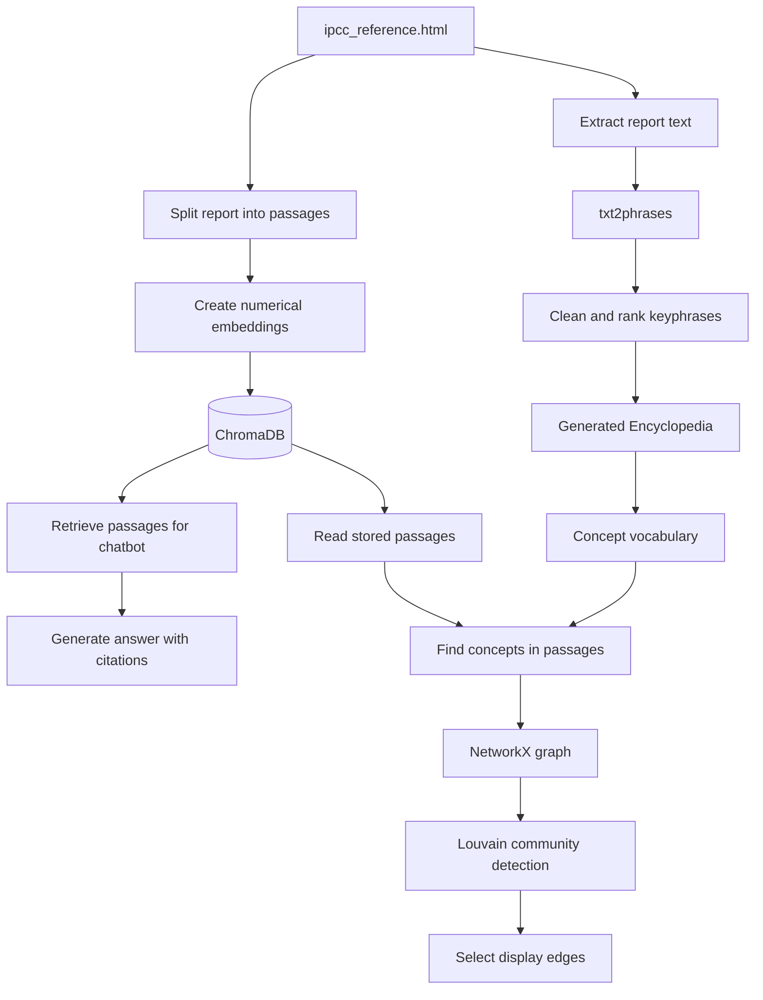

# How ClimateInsight Builds Its Chatbot Knowledge and Knowledge Graph

## A simple but detailed guide

ClimateInsight contains two connected systems:

1. **The chatbot** searches IPCC report passages and uses them to answer questions.
2. **The knowledge graph** finds climate concepts in those passages and displays how often the concepts appear together.

The chatbot does not normally use the graph as its main source of facts. Its evidence comes from IPCC passages stored in ChromaDB. The graph is a visual map built from concepts found in the same collection of passages.



## 1. The starting document

The main source document is:

```text
ClimateInsight/data/raw/ipcc_reference.html
```

It is an HTML version of the IPCC reference report. It contains headings, sections and paragraphs such as statements about human activity, greenhouse gas emissions and global warming.

ClimateInsight uses this report in two ways:

- Its passages provide evidence for chatbot answers.
- Its language provides candidate terms for the Encyclopedia and knowledge graph.

## 2. Preparing knowledge for the chatbot

Before the chatbot can answer questions, the report is divided into smaller passages. A passage is normally a paragraph-sized piece of the report with metadata such as the document title and section number.

Conceptually, a stored passage looks like this:

```json
{
  "text": "Human activities have unequivocally caused global warming...",
  "document_title": "SYR Longer Report",
  "section": "2.1",
  "source_type": "ipcc_report"
}
```

### Embeddings

Each passage is converted into an **embedding**. An embedding is a list of numbers that represents the meaning of text.

```text
"global warming caused by emissions"
                  |
                  v
[0.12, -0.34, 0.81, 0.07, ...]
```

Texts with similar meanings usually receive nearby numerical representations. This means a question such as "What causes climate change?" can match a passage saying "Human greenhouse gas emissions have caused global warming," even though the wording is different.

### ChromaDB

The passage text, metadata and embeddings are stored in ChromaDB:

```text
ClimateInsight/backend/chroma_db/
```

The code that opens the Chroma collection is:

```text
ClimateInsight/backend/vectorstore/chroma_client.py
```

The code that searches the collection is:

```text
ClimateInsight/backend/vectorstore/retriever.py
```

ChromaDB is therefore the chatbot's semantic search system. It finds passages by meaning rather than relying only on exact word matches.

## 3. Generating the Encyclopedia vocabulary

The new Encyclopedia also starts with `ipcc_reference.html`, but it performs a different task. It extracts important terminology from the report.

The explicit build entry point is:

```text
ClimateInsight/backend/build_ipcc_encyclopedia.py
```

The ClimateInsight adapter for the Encyclopedia workflow is:

```text
ClimateInsight/backend/ipcc_encyclopedia_pipeline.py
```

The workflow is:

```text
IPCC HTML
  -> extract paragraphs
  -> run txt2phrases
  -> collect candidate phrases
  -> clean duplicates and capitalization
  -> rank phrases
  -> select terms
  -> create Encyclopedia entries
```

## 4. What txt2phrases does

`txt2phrases` is a Python package for keyphrase extraction. It receives text and predicts which words form important phrases.

For this sentence:

> Climate change has reduced food security and affected water security.

It might return:

- climate change
- food security
- water security

The configured keyphrase model is:

```text
ml6team/keyphrase-extraction-kbir-inspec
```

The extraction is automatic rather than a manually written term list. However, developers still configure the surrounding process: which document is read, which model is used, how phrases are cleaned, how duplicates are combined and how many terms are retained.

`txt2phrases` does not build the graph, query ChromaDB, generate chatbot answers or run clustering. It only proposes keyphrases.

## 5. Cleaning and selecting phrases

Model output must be cleaned. The pipeline performs operations such as:

- Combining capitalization variants such as `Climate Change` and `climate change`.
- Combining repeated phrases.
- Ranking phrases by their extraction results and occurrences.
- Removing unsuitable or unsafe aliases.
- Limiting the final number of selected terms.

The current generated build contains approximately 300 selected phrases. Extraction is automated, but it is not infallible. It can produce general words, incomplete phrases, ambiguous terms and missing concepts.

## 6. Generated Encyclopedia outputs

The build produces files under:

```text
ClimateInsight/encyclopedia/generated/
```

### `wordlist.csv`

```text
ClimateInsight/encyclopedia/generated/wordlist.csv
```

This contains the ranked phrases and identifies which terms were selected.

### `ipcc_encyclopedia.html`

```text
ClimateInsight/encyclopedia/generated/ipcc_encyclopedia.html
```

This is the generated, human-readable Encyclopedia. Its entries use the Encyclopedia project's `ami_entry` structure.

### `build.json`

```text
ClimateInsight/encyclopedia/generated/build.json
```

This records information about the build, including the source report, source checksum, settings and output counts.

### `encyclopedia_concepts.json`

```text
ClimateInsight/backend/data/generated/encyclopedia_concepts.json
```

This is the main vocabulary export used by the knowledge graph. An entry can contain a concept name, aliases, description, Wikidata ID and Wikipedia URL.

## 7. Optional Wikipedia and Wikidata enrichment

Wikipedia is an optional enrichment source. It is not the source of the extracted keyphrases.

The intended sequence is:

```text
IPCC phrase
  -> find matching Wikipedia/Wikidata concept
  -> attach description, URL and stable Wikidata identity
```

During the current build, Wikipedia endpoints returned HTTP 403 responses. The system therefore retained the IPCC-derived terms, but most generated concepts currently lack Wikipedia descriptions, Wikidata IDs and Wikipedia URLs.

The vocabulary can still be used for matching without this enrichment.

## 8. The role of climate-wiki.js

The current viewer is:

```text
ClimateInsight/encyclopedia/climate-wiki.js
```

Its main job is to display the generated Encyclopedia in the browser. It renders entries, supports browsing and filtering, and shows descriptions or links when they are available.

It does not run `txt2phrases`, build embeddings, search ChromaDB, construct the NetworkX graph or run Louvain clustering.

The older manually populated implementation is preserved at:

```text
ClimateInsight/encyclopedia/climate-wiki.legacy.js
```

That file preserves the earlier manually maintained `WIKI_MAP` implementation for comparison or rollback.

## 9. Loading concepts into the graph builder

The graph implementation is located in:

```text
ClimateInsight/backend/knowledge_graph.py
```

It loads the generated concepts from `encyclopedia_concepts.json`. It also retains compatibility with existing public concept IDs and older manual concepts.

This identity handling matters because the same concept can appear as:

```text
Greenhouse gas emissions
greenhouse gas emissions
GHG emissions
```

The graph should treat these as one concept when the identity evidence supports that conclusion. A Wikidata ID provides a stable identity when one is available. Existing public graph IDs are retained for API and frontend compatibility.

## 10. Finding concepts in passages

The graph builder examines the stored IPCC passages and searches for known concept names and aliases.

For example, in this passage:

> Greenhouse gas emissions have caused global warming, creating a need for adaptation.

the matcher may find:

- greenhouse gas emissions
- global warming
- adaptation

Each unique concept becomes a **node** in the NetworkX graph. A node can contain a display label, public ID, aliases, description, Wikidata ID, Wikipedia URL and source information.

## 11. Creating edges through co-occurrence

When two concepts appear in the same passage, ClimateInsight connects them with an **edge**.

Using the previous example, the graph would contain connections among greenhouse gas emissions, global warming and adaptation.

This is a **co-occurrence relationship**. It means the concepts were discussed in the same passage. It does not prove that one concept causes another, that one is a subtype of another, or that the IPCC stated a formal semantic relationship.

## 12. Edge weights

An edge receives a weight based on repeated co-occurrence. If two concepts occur together in many passages, their connection becomes stronger.

| Concept pair | Shared passages | Interpretation |
|---|---:|---|
| Climate change - Adaptation | 12 | Strong repeated co-occurrence |
| Climate change - Food security | 7 | Medium repeated co-occurrence |
| Carbon tax - Food security | 1 | Weak co-occurrence |

This existing passage co-occurrence weighting algorithm was preserved.

## 13. Bridge edges

Some graph regions may be disconnected. ClimateInsight can add weak **bridge edges** so the displayed graph remains connected.

These bridge edges use a weight of `0.5`. That is weaker than an ordinary co-occurrence connection and shows that the edge was added for graph structure rather than repeated textual co-occurrence.

This existing bridge behavior was preserved.

## 14. Louvain community detection

Yes, ClimateInsight uses a clustering algorithm: **Louvain community detection**.

Louvain examines:

- which concepts are connected;
- how strong those connections are; and
- whether a set of concepts has stronger internal connections than connections to the rest of the graph.

It then assigns nodes to communities. A result might place emissions-related terms together, impact-related terms together and response-related terms together.

Louvain discovers communities from graph structure. It does not understand climate science like a human expert and it is not given a fixed list of climate categories.

Communities may change when the report, vocabulary, concept matches or edge weights change. The existing Louvain algorithm was preserved.

## 15. Selecting display edges

A large graph can contain too many edges to show clearly. ClimateInsight therefore chooses a smaller set of display edges. It favors useful connections while retaining important nodes, community structure and connections between graph regions.

This controls what is drawn in the browser. It does not change the stored passages, embeddings or chatbot evidence. The existing display-edge selection algorithm was preserved.

## 16. How the chatbot answers a question

The chat API route is located in:

```text
ClimateInsight/backend/app.py
```

It calls the retrieval pipeline in:

```text
ClimateInsight/backend/retrieval/pipeline.py
```

The answer flow is:

```text
User question
  -> create/search using the question meaning
  -> retrieve the closest IPCC passages from ChromaDB
  -> send the question and passages to the answer model
  -> return an answer with IPCC citations
```

The chatbot's main factual evidence is the retrieved IPCC text. The graph is a related visual analysis of concepts found in those passages.

## 17. Files changed for the Encyclopedia integration

| File | Responsibility |
|---|---|
| `backend/build_ipcc_encyclopedia.py` | Explicit command for building the Encyclopedia from the IPCC HTML source. |
| `backend/ipcc_encyclopedia_pipeline.py` | Connects ClimateInsight to the Encyclopedia extraction and entry-generation workflow. |
| `backend/encyclopedia_service.py` | Loads generated artifacts and validates the source checksum at runtime. |
| `backend/app.py` | Serves Encyclopedia routes and JSON API errors. The answer-generation algorithm was not changed. |
| `backend/knowledge_graph.py` | Loads generated concepts and resolves them against existing graph identities while preserving the graph algorithms. |
| `encyclopedia/climate-wiki.js` | Displays the generated Encyclopedia in the browser. |
| `encyclopedia/climate-wiki.legacy.js` | Preserves the previous manual `WIKI_MAP` implementation. |
| `backend/data/generated/encyclopedia_concepts.json` | Generated concept vocabulary used for graph matching. |
| `encyclopedia/generated/wordlist.csv` | Ranked and selected keyphrases. |
| `encyclopedia/generated/ipcc_encyclopedia.html` | Generated human-readable Encyclopedia. |
| `encyclopedia/generated/build.json` | Build metadata and source checksum. |
| `config.toml` | Selects generated Encyclopedia mode and identifies the source and sibling repository. |
| `requirements-encyclopedia.txt` | Keeps extraction dependencies separate from normal chatbot runtime dependencies. |
| `backend/tests/test_encyclopedia_integration.py` | Focused integration and API regression tests. |
| `frontend/js/api.js` | Detects HTML API failures and reports the exact endpoint and status. It does not alter answers. |

## 18. The Chroma compatibility repair

The chatbot later failed because the stored Chroma database had been migrated to a newer schema while ClimateInsight was running its pinned Chroma `0.4.24` package.

The database is:

```text
ClimateInsight/backend/chroma_db/chroma.sqlite3
```

Compatibility fields were restored and one sequence value was converted back to the format expected by `0.4.24`. The repair did not change stored passage text, embeddings, retrieval ranking, prompts, answer generation, Encyclopedia concepts or graph algorithms.

After the repair:

- ChromaDB opened successfully.
- The collection contained 118 passages.
- A real nearest-vector query succeeded.
- A real `/api/chat` request returned HTTP 200.
- The answer included an IPCC citation.

The backup is stored at:

```text
ClimateInsight/.venv/encyclopedia-integration-backup/20261103T183925Z-chroma-compat
```

## 19. The complete mental model

The entire system can be remembered as six responsibilities:

1. **IPCC HTML** supplies the original scientific text.
2. **ChromaDB** stores passage embeddings and retrieves evidence for chatbot questions.
3. **txt2phrases** proposes important terminology from the report.
4. **The generated Encyclopedia** stores and displays the selected concepts.
5. **NetworkX** creates a concept co-occurrence graph from passage matches.
6. **Louvain** groups strongly connected concepts into communities.

The chatbot answers from retrieved IPCC passages. The knowledge graph shows how Encyclopedia concepts occur together across those passages.
