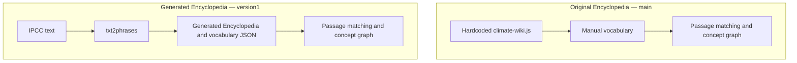

# ClimateInsight: Original and Generated Encyclopedia Implementations

**Project summary · 4 November 2026**

**Authors: Anusha Garg and Aleena Harold Peter**

- **Project objective:** ClimateInsight helps people explore climate evidence through an Encyclopedia, a cited-answer chatbot and a concept graph, with an original hardcoded Encyclopedia and a newer automatically generated Encyclopedia.

- **Source:** The Encyclopedia extraction uses the [IPCC AR6 Synthesis Report (2023), Longer Report, Sections 1–4](https://www.ipcc.ch/report/ar6/syr/longer-report/), while the earlier manual-vocabulary graph example also includes 12 Europe PMC papers selected with `("marine heatwave" OR "ocean heat wave" OR "ocean heatwave") AND ("ocean current" OR "ocean circulation" OR "Gulf Stream" OR "AMOC") AND (HAS_FT:Y)`.

- **Technical plan:** The original Encyclopedia reads `WIKI_MAP`, while the newer implementation uses `txt2phrases` (`ml6team/keyphrase-extraction-kbir-inspec`) and the semanticClimate Encyclopedia package to generate its own entries and vocabulary; the downstream system uses `sentence-transformers/all-MiniLM-L6-v2` and ChromaDB for retrieval, NetworkX and Louvain for graphs, vis-network for display, and Llama 3.2 through Ollama for cited answers.

- **Repository/corpus:** Code is in [semanticClimate/ClimateInsight](https://github.com/semanticClimate/ClimateInsight) and [semanticClimate/encyclopedia](https://github.com/semanticClimate/encyclopedia), with the [IPCC report](https://github.com/semanticClimate/ClimateInsight/blob/version1/data/raw/ipcc_reference.html), [research-paper corpus](https://github.com/semanticClimate/ClimateInsight/tree/version1/data/raw/ocean_heatwaves_2026) and [generated concept vocabulary](https://github.com/semanticClimate/ClimateInsight/blob/version1/backend/data/generated/encyclopedia_concepts.json) stored in ClimateInsight.

- **What was implemented:** Anusha Garg and Aleena Harold Peter implemented Encyclopedia in **two alternative ways**—hardcoded terms in `encyclopedia/climate-wiki.js` on `main`, and report-derived entries on `version1`—with the new generated mode using only its generated vocabulary and excluding terms from `climate-wiki.legacy.js`.

- **Results obtained:** The generated-Encyclopedia build exported **300 IPCC-derived concepts** without Wikipedia/Wikidata enrichment, while the earlier documented manual-vocabulary run reported **273 graph nodes, 5,286 passage co-occurrence links and five Louvain communities from 418 passages**, which are separate measurements from different builds.

- **What the results mean:** The newer Encyclopedia replaces manual term maintenance with extraction from the report, while the graph still depends on matches between the selected implementation's vocabulary and indexed passages, and co-occurrence does not establish causation.

- **Where knowledge graphs are involved:** Matched concepts become nodes, concepts sharing a passage receive an undirected edge weighted by their shared-passage count, Louvain groups connected concepts into communities, and questions highlight existing graph concepts while the answer model uses retrieved passages without adding nodes or edges.

