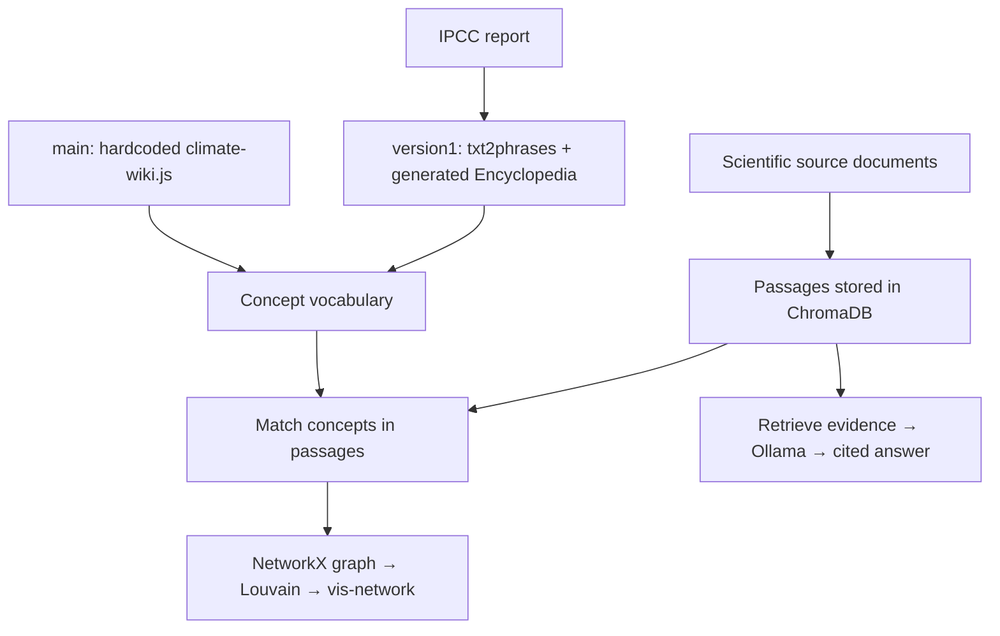

# ClimateInsight: Chatbot, Encyclopedia and Knowledge Graph

**Project summary · 4 November 2026**

**Authors: Anusha Garg and Aleena Harold Peter**

- **Project objective:** ClimateInsight helps people ask climate questions, inspect the scientific passages cited in answers, and explore how climate concepts are discussed together.

- **Source:** The Encyclopedia extraction uses the [IPCC AR6 Synthesis Report (2023), Longer Report, Sections 1–4](https://www.ipcc.ch/report/ar6/syr/longer-report/), while the earlier manual-vocabulary graph example also includes 12 Europe PMC papers selected with `("marine heatwave" OR "ocean heat wave" OR "ocean heatwave") AND ("ocean current" OR "ocean circulation" OR "Gulf Stream" OR "AMOC") AND (HAS_FT:Y)`.

- **Technical plan:** The pipeline splits documents into passages of up to 400 words with 50-word overlap, indexes `sentence-transformers/all-MiniLM-L6-v2` embeddings in ChromaDB, extracts terminology with `txt2phrases` using `ml6team/keyphrase-extraction-kbir-inspec` for the generated Encyclopedia, builds graphs with NetworkX and Louvain community detection, displays them with vis-network, and generates cited answers with Llama 3.2 through Ollama.

- **Repository/corpus:** Code is in [semanticClimate/ClimateInsight](https://github.com/semanticClimate/ClimateInsight) and [semanticClimate/encyclopedia](https://github.com/semanticClimate/encyclopedia), with the [IPCC report](https://github.com/semanticClimate/ClimateInsight/blob/version1/data/raw/ipcc_reference.html), [research-paper corpus](https://github.com/semanticClimate/ClimateInsight/tree/version1/data/raw/ocean_heatwaves_2026) and [generated concept vocabulary](https://github.com/semanticClimate/ClimateInsight/blob/version1/backend/data/generated/encyclopedia_concepts.json) stored in ClimateInsight.

- **What was implemented:** Anusha Garg and Aleena Harold Peter implemented Encyclopedia in **two ways**—a hardcoded term-and-alias dictionary in `encyclopedia/climate-wiki.js` on `main`, and an IPCC-derived Encyclopedia generated using the semanticClimate Encyclopedia repository and `txt2phrases` on `version1`—with both feeding the shared concept-matching and graph-generation process.

- **Results obtained:** The generated-Encyclopedia build exported **300 IPCC-derived concepts** without Wikipedia/Wikidata enrichment, while the earlier documented manual-vocabulary run reported **273 graph nodes, 5,286 passage co-occurrence links and five Louvain communities from 418 passages**, which are separate measurements from different builds.

- **What the results mean:** The two implementations provide alternative vocabularies for exploring indexed evidence, but graph size depends on passage matches, missing links can reflect limited vocabulary or corpus coverage, and co-occurrence does not establish causation.

- **Where knowledge graphs are involved:** Matched concepts become nodes, concepts sharing a passage receive an undirected edge weighted by their shared-passage count, Louvain groups connected concepts into communities, and questions highlight existing graph concepts while the answer model uses retrieved passages without adding nodes or edges.

