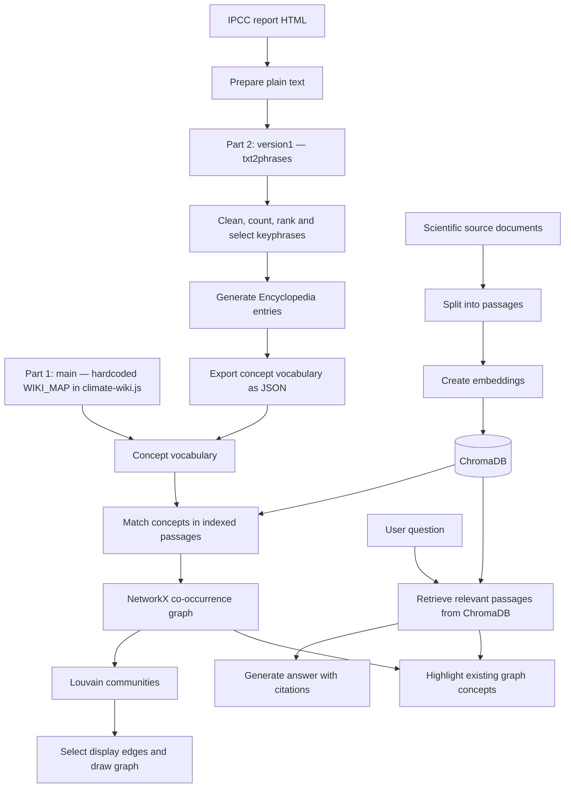

# How ClimateInsight Builds Its Chatbot Knowledge and Knowledge Graph

ClimateInsight has two connected systems. The **chatbot** retrieves scientific passages and uses them to generate answers with citations. The **knowledge graph** shows which climate concepts appear together in those passages.

**We have implemented Encyclopedia in ClimateInsight in two ways:**

1. **Part 1 — Hardcoded Encyclopedia on `main`:** predefined terms and aliases are maintained in `encyclopedia/climate-wiki.js` and used as the concept vocabulary.
2. **Part 2 — Generated Encyclopedia on `version1`:** the semanticClimate Encyclopedia repository and `txt2phrases` extract keyphrases from the IPCC report, generate Encyclopedia entries and export the concept vocabulary.

Both routes feed the same passage-matching and graph-building process. The vocabulary determines which concepts the graph can recognize; the indexed passages provide the evidence for their connections and for chatbot answers.

The `main` description and its example results follow the supplied main-branch notes. The `version1` description follows the local integration code and generated artifacts. Counts describe particular builds, rather than fixed properties of either branch.



## Part 1 — Taking keyphrases from `climate-wiki.js` on `main`

### 1. The vocabulary is predefined

In this route, the terms are already written into:

```text
encyclopedia/climate-wiki.js
```

The script contains a hardcoded `WIKI_MAP` that maps terms and alternative spellings to Wikipedia article titles. For example:

```javascript
const WIKI_MAP = {
  "greenhouse gas emissions": "Greenhouse gas emissions",
  "greenhouse gases": "Greenhouse gas",
  "greenhouse gas": "Greenhouse gas",
  "sea level rise": "Sea level rise",
  "sea-level rise": "Sea level rise",
  "food security": "Food security"
};
```

The **keys** are the words and phrases to search for. The **values** identify the concepts. Several keys can identify the same concept: `sea level rise` and `sea-level rise` both become *Sea level rise*.

Here, “taking keyphrases” means reading an existing dictionary. There is no automatic keyphrase extraction from the report in this route, and `txt2phrases` is not used. The supplied notes attribute the manually maintained list to Aleena Harold Peter.

### 2. The same list supports the browser and graph

The JavaScript uses the dictionary to recognize climate terms in the report and provide Wikipedia tooltips and article views. The main-branch graph workflow described in the supplied notes also reads this dictionary as its concept vocabulary.

The Wikipedia article title supplies the concept identity. It does not mean Wikipedia article text is the chatbot's scientific evidence: that evidence comes from the documents indexed in ChromaDB.

The term list is manually maintained and should not be described as the IPCC glossary.

### 3. The vocabulary enters the shared graph process

```text
Hardcoded WIKI_MAP in climate-wiki.js
  -> read terms and their concept identities
  -> match those terms in indexed passages
  -> build the shared co-occurrence graph
```

A listed concept becomes a graph node only when it is found in at least one indexed passage. A concept missing from the dictionary cannot appear as a node, even when the source documents discuss it.

## Part 2 — Taking keyphrases from the generated Encyclopedia on `version1`

### 1. The semanticClimate Encyclopedia repository provides the workflow

This route uses the separate semanticClimate **Encyclopedia** repository to extract terminology and generate entries. The local layout distinguishes the reusable repository from ClimateInsight's output folder:

```text
semantic_climate/
├── encyclopedia/                 # Separate Encyclopedia repository
└── ClimateInsight/
    ├── data/raw/ipcc_reference.html
    ├── encyclopedia/generated/    # Generated Encyclopedia outputs
    └── backend/data/generated/    # Vocabulary export used by the graph
```

The sibling repository is selected in ClimateInsight's `config.toml`, normally using `repository = "../encyclopedia"` under `[encyclopedia]`.

The ClimateInsight build entry point is `backend/build_ipcc_encyclopedia.py`. Its adapter, `backend/ipcc_encyclopedia_pipeline.py`, reuses the Encyclopedia project's text preparation, keyphrase extraction, case/count aggregation and entry-generation functions.

### 2. Prepare the IPCC report as text

The configured source is:

```text
data/raw/ipcc_reference.html
```

The adapter removes scripts, styles, navigation and embedded Encyclopedia content before preparing text for extraction. This prevents the vocabulary build from extracting terms from its own previously rendered glossary.

This preparation is separate from chatbot ingestion. Building the Encyclopedia does not add passages or embeddings to ChromaDB.

### 3. Extract candidate keyphrases with `txt2phrases`

The prepared report text is passed to `txt2phrases`. The recorded extraction model is:

```text
ml6team/keyphrase-extraction-kbir-inspec
```

For an illustrative sentence such as:

> Climate change has affected food security and water security.

the extractor might propose `climate change`, `food security` and `water security`.

This stage uses a trained model to propose phrases. Developers configure the source, extraction settings and selection rules. `txt2phrases` supplies terminology; the existing ClimateInsight code subsequently builds the graph.

### 4. Clean, rank and select phrases

The pipeline combines capitalization variants and repeated extractions, filters candidates, ranks them by aggregated extraction counts and selects the highest-ranked terms.

The recorded build settings are:

| Setting | Value | Purpose |
|---|---:|---|
| `top_n` | 500 | Passed to the keyphrase extractor |
| `max_terms` | 300 | Maximum number of selected terms |
| `min_count` | 2 | Minimum aggregated extraction count |

These are selection parameters rather than a hardcoded vocabulary. Extraction counts are also different from graph edge weights: graph weights count shared indexed passages later in the process.

### 5. Generate Encyclopedia entries and export the vocabulary

The selected phrases are passed to the Encyclopedia project's shared entry generator. ClimateInsight then exports a normalized vocabulary for its viewer and graph.

| Output | Role |
|---|---|
| `encyclopedia/generated/ipcc_reference.txt` | Prepared text used for extraction |
| `encyclopedia/generated/wordlist.csv` | Ranked phrases, extraction counts and selection flags |
| `encyclopedia/generated/ipcc_encyclopedia.html` | Human-readable Encyclopedia using `ami_entry` elements |
| `encyclopedia/generated/build.json` | Source checksum, model, settings and build summary |
| `backend/data/generated/encyclopedia_concepts.json` | Normalized concept vocabulary loaded by the application |

Concept records can contain a canonical name, synonyms, description, Wikidata ID, Wikipedia URL and source information. Available Wikidata identities can group synonymous entries. An unresolved phrase can remain a concept under its extracted name.

Wikipedia and Wikidata enrichment is optional. The installed build records `wikipedia_requested = false`, 300 exported concepts and no resolved descriptions or Wikidata IDs. The integration notes report HTTP 403 responses during earlier Wikipedia access attempts. Matching can still use the extracted terms without enrichment.

### 6. Load the generated vocabulary

`backend/encyclopedia_service.py` loads the generated artifact and checks its source checksum. `backend/knowledge_graph.py` receives the resulting concept names and accepted aliases for matching.

In generated mode, the active vocabulary comes from this report-derived artifact. The old manual dictionary is available through an explicit legacy mode.

The role of `climate-wiki.js` therefore differs between the two routes:

| Route | Role of `climate-wiki.js` |
|---|---|
| Part 1: `main` | Contains the predefined `WIKI_MAP` vocabulary and browser interaction code |
| Part 2: `version1` generated mode | Acts as a viewer template supplied with generated vocabulary at runtime |

The integration preserves the former manual script as `encyclopedia/climate-wiki.legacy.js`.

```text
IPCC HTML
  -> prepare text using the Encyclopedia workflow
  -> extract keyphrases with txt2phrases
  -> clean, count, rank and select
  -> generate Encyclopedia entries
  -> export encyclopedia_concepts.json
  -> build the shared co-occurrence graph
```

## Shared process — Preparing chatbot evidence and building the graph

### 1. Split source documents into passages and store embeddings

The ingestion workflow divides source documents into passages of up to 400 words with a 50-word overlap. Each passage retains source metadata, such as its report section or paper identifier.

The embedding model `all-MiniLM-L6-v2` converts each passage into a numerical representation. ChromaDB stores the passage text, metadata and embeddings under `backend/chroma_db/`, allowing questions to retrieve passages by semantic similarity.

The supplied `main` example contains the IPCC AR6 Synthesis Report and 12 Europe PMC research papers, producing 418 passages: 118 report passages and 300 paper passages. The supplied `version1` example describes an IPCC-only collection of 118 passages. These are corpus snapshots. Changing the vocabulary source does not itself add or remove documents from ChromaDB.

### 2. Match vocabulary terms in the indexed passages

`ConceptMatcher` in `backend/knowledge_graph.py` searches the stored passage text for known terms and aliases. This is lexical, dictionary-based matching.

The shared rules include:

- Prefer longer matching phrases over overlapping shorter phrases.
- Apply term boundaries and case-insensitive matching, with additional capitalization checks for abbreviations such as `NO`.
- Rejoin flattened chemical formulas such as `CO 2` before matching.
- Combine aliases that identify the same concept.
- Exclude the uncertainty-language concept *Likelihood* from the graph.

The matcher recognizes only the names and aliases supplied by the chosen vocabulary. It does not automatically infer every plural, abbreviation or synonym. Generated concepts also pass through alias filtering before reaching the matcher.

### 3. Create concept nodes

Every concept matched in at least one indexed passage becomes a node. Each node records information such as its label, passage count, source references, neighbours and community. Generated Encyclopedia metadata is attached when available.

Mentioning a concept repeatedly in one passage still contributes only one to that node's passage count. Likewise, 300 exported Encyclopedia concepts do not necessarily produce 300 graph nodes: filtering and passage matching determine the actual node set.

### 4. Connect concepts that share a passage

For each passage, the builder connects every pair of distinct concepts found in it. Each shared passage adds one to that pair's edge weight.

For example, if an illustrative passage matches *Greenhouse gas emissions*, *Global warming* and *Climate change adaptation*, it contributes three pairs:

```text
Greenhouse gas emissions — Global warming
Greenhouse gas emissions — Climate change adaptation
Global warming — Climate change adaptation
```

If two concepts share 12 passages, their co-occurrence edge has weight 12. Multiple mentions within one passage do not increase that contribution.

An ordinary edge is undirected and means **“these concepts occur in the same passage.”** It does not establish a causal relationship or a formal scientific relation.

### 5. Add weak source bridges where possible

When a component has no passage connection to the main component, the code can connect it through a shared source section or paper. These source bridges have weight `0.5` and are displayed as dashed links.

A source bridge indicates shared source context rather than a shared passage. Components without a suitable shared source can remain disconnected.

### 6. Detect communities with Louvain

NetworkX runs Louvain community detection on the full weighted graph, including any source bridges, using seed `42`.

Louvain finds groups with relatively strong internal connections. It uses graph structure and weights; it does not read the question or ask an LLM to choose categories. The application names each community after its most-mentioned concept.

Changing the vocabulary or corpus can change the communities even when the Louvain implementation and seed remain the same.

### 7. Select display edges and draw the graph

To keep the visualization readable, the application displays the union of:

- a maximum spanning forest, retaining strong paths within each connected component; and
- each concept's three strongest links.

Clustering still uses the full weighted graph. `vis-network` renders the selected nodes and edges in the browser.

The corpus graph is cached and reused across questions, with rebuilding triggered by the application's collection and vocabulary checks.

### 8. Answer questions and highlight relevant concepts

When a user asks a question:

1. The embedding model represents the question numerically.
2. ChromaDB retrieves up to six relevant passages.
3. The answer model receives the question and retrieved evidence and generates an answer with source citations. The local configuration defaults to Llama 3.2 through Ollama.
4. For the graph view, the matcher identifies existing concepts in the question and retrieved passages. Up to 15 concepts are selected, with up to three asked-about concepts prioritized.
5. The interface highlights those concepts and their existing connections.

The question and generated answer do not add graph nodes or edges. The chatbot's factual evidence comes from retrieved passages. Citation processing removes references that do not correspond to retrieved sources, although citation validity alone does not prove that every claim is supported.

## Where AI is involved

| Stage | Part 1: manual vocabulary | Part 2: generated Encyclopedia |
|---|---|---|
| Obtain candidate terms | Read the predefined dictionary; no extraction model runs | `txt2phrases` uses a trained keyphrase model |
| Match terms in passages | Dictionary-based matching | Dictionary-based matching using generated terms and aliases |
| Create nodes and weighted edges | Match and count passages | Same process |
| Assign communities | Louvain; no trained model | Same process |
| Retrieve passages | Embedding model and ChromaDB | Same process |
| Write answers or graph explanations | LLM using retrieved evidence | Same process |

The graph construction stage uses matching, counting and graph algorithms. In Part 2, its input vocabulary has already been proposed by a trained model, so describing the entire pipeline as “AI-free” would be inaccurate.

## Example results and their interpretation

The supplied `main` notes report the following results for the manual-vocabulary run:

| Measurement | Reported result |
|---|---:|
| Indexed passages | 418 |
| Candidate concept identities after excluding *Likelihood* | 507 |
| Concepts matched as graph nodes | 273 |
| Passage co-occurrence edges | 5,286 |
| Additional source bridges | 1 |
| Displayed edges | 828 |
| Louvain communities with seed 42 | 5 |

These values should not be carried over as results for the generated-Encyclopedia route. Its installed build exports 300 concepts, but graph measurements require running the graph against the chosen indexed corpus.

The supplied example question asks how marine heatwaves in the Bay of Bengal affect food security in coastal fishing communities. In that manual-vocabulary run, *Marine heatwave* and *Food security* have no direct co-occurrence edge. The notes identify fisheries-related language in the corpus that is missing from the vocabulary, illustrating how the term list limits the graph's coverage.

That is a finding about the selected corpus and vocabulary. It does not establish a gap in climate research, and automatic extraction alone does not guarantee that the generated vocabulary will repair it.

## Limits that apply to both routes

- **Vocabulary coverage:** relevant concepts can be omitted by manual selection or missed by automatic extraction.
- **Lexical matching:** unlisted spellings, abbreviations and plurals can be missed.
- **Corpus coverage:** answers and graph connections depend on which scientific documents are indexed.
- **Co-occurrence meaning:** concepts appearing together do not automatically have a causal relationship.
- **Raw counts:** common concepts can dominate edge weights.
- **Community variation:** different inputs or random seeds can produce different clusters.
- **Generated terminology quality:** extracted phrases and optional Wikipedia resolutions need review for ambiguity and incomplete terms.

The two routes change how ClimateInsight obtains its concept vocabulary. They share the same downstream graph logic: match concepts in indexed passages, count co-occurrences, add source bridges where appropriate, detect communities and display the result alongside passage-based chatbot answers.
