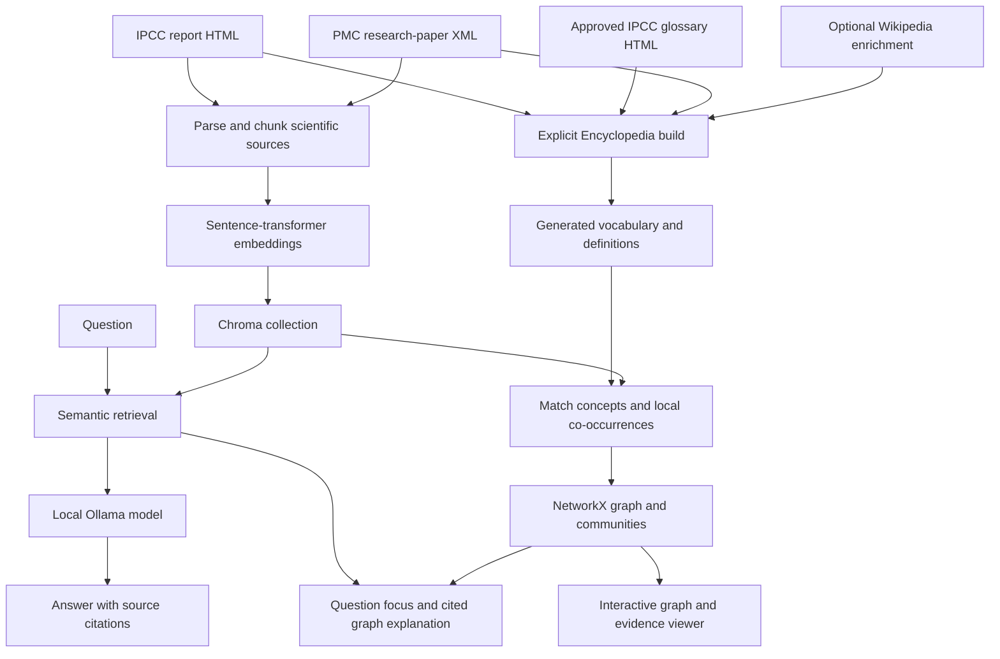
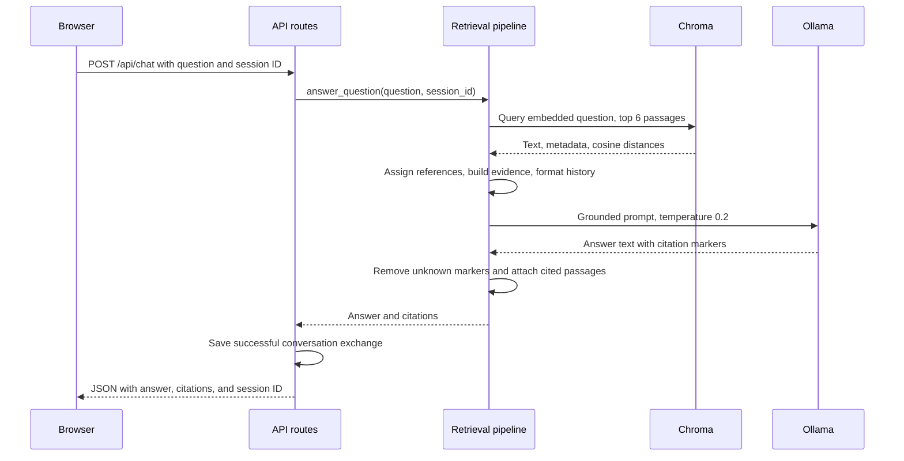

# ClimateInsight: architecture and developer guide

This is the main technical reference for the current implementation. The
[README](../README.md) covers installation and everyday use. This guide explains
what each component does, how documents become answers and graph evidence,
where generated files live, and how to maintain the system.

## Contents

1. [What the application does](#1-what-the-application-does)
2. [Folder and module map](#2-folder-and-module-map)
3. [Documents and generated data](#3-documents-and-generated-data)
4. [Ingestion and vector indexing](#4-ingestion-and-vector-indexing)
5. [Question answering and citations](#5-question-answering-and-citations)
6. [Encyclopedia and glossary construction](#6-encyclopedia-and-glossary-construction)
7. [Knowledge graph generation](#7-knowledge-graph-generation)
8. [Questions on the graph](#8-questions-on-the-graph)
9. [Frontend and source viewing](#9-frontend-and-source-viewing)
10. [HTTP API](#10-http-api)
11. [Technology and configuration](#11-technology-and-configuration)
12. [Commands and maintenance](#12-commands-and-maintenance)
13. [Limits and interpretation](#13-limits-and-interpretation)
14. [Verification and extension](#14-verification-and-extension)

## 1. What the application does

ClimateInsight combines three related features:

- A chatbot retrieves scientific passages and asks a local language model to
  write a cited answer from them.
- An Encyclopedia explains terms using a vocabulary extracted from the IPCC
  report, glossary HTML and 12 approved PMC XML papers, with official definitions
  and supplementary Wikipedia descriptions and identities.
- A concept knowledge graph shows where vocabulary terms occur near one another
  in the indexed scientific text. Readers can inspect the passages behind nodes
  and relationships.

The chatbot and graph share the same indexed corpus. The Encyclopedia supplies
the graph's vocabulary, but its definitions are not automatically added to the
chatbot's retrieved passages. A Wikipedia definition and an IPCC evidence passage
therefore have separate roles and attribution.



The graph is constructed from text matching and graph algorithms. The answer
model does not invent its nodes, edges, or community assignments.

## 2. Folder and module map

All application Python imports use the `backend` package. Run the documented
module commands from the repository root, the directory containing `config.toml`.

```text
ClimateInsight/
├── backend/
│   ├── app.py                      # Small server entry point
│   ├── api/
│   │   ├── routes.py               # FastAPI routes and request orchestration
│   │   └── responses.py            # JSON response and reference formatting
│   ├── core/
│   │   ├── paths.py                # Shared absolute resource locations
│   │   └── sessions.py             # Redis or in-memory conversation history
│   ├── encyclopedia/
│   │   ├── build.py                # Explicit vocabulary/glossary build command
│   │   ├── pipeline.py             # Adapter to the external extraction package
│   │   ├── importer.py             # Normalize exported Encyclopedia entries
│   │   ├── concepts.py             # Noise filtering, variants, abbreviations
│   │   ├── glossary.py             # PDF conversion and official definitions
│   │   └── service.py              # Load validated artifacts and render views
│   ├── knowledge_graph/
│   │   ├── engine.py               # Matching, nodes, edges, graph cache, evidence
│   │   ├── topics.py               # Local windows, association weights, labels
│   │   └── question.py             # Retrieve evidence and focus a question
│   ├── ingest/
│   │   ├── ingest.py               # Ingestion command and mode selection
│   │   ├── pipeline.py             # File/directory/manifest orchestration
│   │   ├── loader_registry.py      # Supported formats and duplicate handling
│   │   ├── parser.py               # IPCC-style HTML extraction
│   │   ├── xml_parser.py           # Research-paper JATS XML extraction
│   │   ├── chunker.py              # Overlapping sections and stable chunk IDs
│   │   ├── models.py               # Section and Chunk data classes
│   │   └── manifest_ingest/        # Optional semantic_corpus export adapter
│   ├── vectorstore/
│   │   ├── chroma_client.py        # Persistent Chroma client and collection
│   │   ├── embedder.py             # Lazy sentence-transformer loading
│   │   ├── indexer.py              # Add new and prune stale source chunks
│   │   └── retriever.py            # Query embeddings and return passage metadata
│   ├── retrieval/
│   │   ├── pipeline.py             # Chat retrieval-to-answer workflow
│   │   ├── context_builder.py      # Evidence text and per-answer citation keys
│   │   ├── prompt_builder.py       # Format recent conversation history
│   │   └── citation_parser.py      # Match answer markers to retrieved evidence
│   ├── llm/
│   │   ├── client.py               # Local Ollama HTTP requests and errors
│   │   └── prompt_templates.py     # Grounding and citation instructions
│   ├── tests/                     # Unit and integration tests
│   ├── generated_artifacts/       # Installed vocabulary JSON artifacts
│   └── chroma_db/                 # Local generated database, ignored by Git
├── data/raw/                      # Scientific source documents
├── encyclopedia/                  # Bundled compatible Encyclopedia helpers
├── encyclopedia_assets/           # Browser scripts and generated publications
├── frontend/                      # HTML, CSS, JavaScript, and interface images
├── scripts/                       # Optional development/operating tools
├── docs/ARCHITECTURE.md            # This guide
├── poster/                        # Poster text and figures
├── config.toml                    # Project metadata and Encyclopedia settings
├── requirements.txt               # Chatbot runtime dependencies
├── requirements-encyclopedia.txt   # Separate Encyclopedia build dependencies
└── README.md                       # Simple installation and usage guide
```

### Three different Encyclopedia locations

`backend/encyclopedia/` contains this application's Python integration code.
The top-level `encyclopedia_assets/` directory contains browser assets and generated
HTML, wordlists, glossary files, and audit records.

`data/` is reserved for scientific source documents. The backend's built
vocabulary lives in `backend/generated_artifacts/`, so there is no second
`data/` folder. These names distinguish the original documents, Python code,
browser assets, and generated vocabulary.

The top-level `encyclopedia/` Python package bundles the compatible helpers from
[semanticClimate/encyclopedia](https://github.com/semanticClimate/encyclopedia),
including the `encyclopedia.exchange` viewer boundary, IPCC extraction adapters,
wordlist aggregation, and Wikipedia entry generation. Its original license and
source snapshot information are retained alongside the code. Only ClimateInsight
needs to be cloned; no sibling checkout is required.

`[encyclopedia].repository = "."` resolves to the ClimateInsight root, independent
of the current working directory. `service.exchange_module()` verifies the module
location before use. Runtime serving imports only the lightweight exchange
boundary; extraction and enrichment still require the separate build environment.
An explicit repository path or `CLIMATEINSIGHT_ENCYCLOPEDIA_REPO` can select a
compatible development checkout, but neither is needed for normal use. Remove a
stale override when switching back to the bundled helpers.

### Paths and the server entry point

[core/paths.py](../backend/core/paths.py) derives the project root from its own
location. Source documents, the frontend, generated vocabulary, and the existing
database are anchored there rather than relative to the shell's current folder.
Moving Python modules therefore does not move the index or require re-ingestion.

[app.py](../backend/app.py) starts the FastAPI application exported by
[api/routes.py](../backend/api/routes.py) through Uvicorn. The preferred command is
`python -m backend.app`. The earlier direct-script launch styles remain supported.

## 3. Documents and generated data

| Location | What it contains | Used for |
| --- | --- | --- |
| `data/raw/ipcc_reference.html` | IPCC AR6 Synthesis Report, Longer Report | Scientific ingestion, report viewer, vocabulary extraction |
| `data/raw/IPCC_AR6_SYR_Glossary.html` | Approved glossary HTML | Term extraction and verbatim glossary definitions |
| `data/raw/IPCC_AR6_SYR_Glossary.official.pdf` | Original official Annex I PDF | Preserved conversion source; not read by the current 14-document build |
| `data/raw/ocean_heatwaves_2026/PMC<number>.xml` | Full research-paper JATS XML | Scientific ingestion and Encyclopedia term extraction |
| `data/raw/ocean_heatwaves_2026/PMC<number>.html` | Readable paper export | Browser source viewer |
| `data/raw/ocean_heatwaves_2026/PMC<number>_assets/` | Companion local figures | Paper display |
| `data/raw/ocean_heatwaves_2026/review/` | Paper-selection records | Corpus provenance |
| `backend/chroma_db/` | Stored embeddings, text, metadata, and index files | Retrieval and graph evidence |
| `backend/generated_artifacts/encyclopedia_concepts.json` | Active normalized vocabulary | Term matching, graph metadata, definitions |
| `backend/generated_artifacts/encyclopedia_concepts.legacy.json` | Archived imported vocabulary | Explicit legacy mode |
| `encyclopedia_assets/climate-wiki.js` | Generated-vocabulary browser template | Active term viewer |
| `encyclopedia_assets/climate-wiki.legacy.js` | Original manual term map and viewer | Explicit legacy mode |
| `encyclopedia_assets/generated/` | Published Encyclopedia and build records | Definitions, validation, and reproducibility |

The IPCC PDF/Word copies are reference copies; the running chatbot reads the HTML
source. The normal PMC workflow does not require PDF or Word versions.

The corpus in this checkout was checked on 8 November 2026: 12 XML/HTML paper
pairs and 408 indexed passages, comprising 118 IPCC and 290 paper passages.
These are a verification snapshot, not fixed limits or expected counts for every
future corpus. The rebuilt vocabulary includes the 126 official glossary
definitions and terms from all 14 documents; `generated/build.json` records the
current entry count. The graph matcher can exclude entries that do not
belong in the graph, and terms absent from indexed text produce no nodes.

### Generated Encyclopedia records

| Output under `encyclopedia_assets/generated/` | Purpose |
| --- | --- |
| `source_manifest.json` | The 14 allowed scientific documents, hashes, titles and term counts |
| `extraction/<source-stem>/` | Per-document prepared text, model wordlist and validated extraction provenance |
| `wordlist.csv` | Accepted terms with their originating file and selection flag |
| `ipcc_encyclopedia.html` | Published vocabulary, definitions and approved source passages |
| `extracted_concepts.json` | The current corpus vocabulary with Wikipedia and source provenance |
| `concept_cleanup.json` | Exclusions, merged variants, and abbreviation witnesses |
| `build.json` | Build summary and provenance |

Older report-only snapshots, prepared text, `glossary/` conversion records and
audit/comparison files are historical outputs. The current build does not read
them as additional scientific inputs. Their counts should not be presented as
current application statistics. The approved glossary input is the HTML under
`data/raw/`.

## 4. Ingestion and vector indexing

### 4.1 Select inputs

The ingestion command supports three input routes:

```bash
# Default IPCC HTML source
python -m backend.ingest.ingest

# All supported scientific sources in the paper directory
python -m backend.ingest.ingest --dir data/raw/ocean_heatwaves_2026

# A semantic_corpus export supplied by another project
python -m backend.ingest.ingest --manifest /path/to/chatbot_manifest.json
```

`--xml-dir` remains an alternative directory flag. Directory discovery supports
`.html`, `.htm`, and `.xml`. It recognizes that `PMC10468509.xml`,
`PMC10468509.html`, and `10468509.html` represent the same paper and selects the
XML when both formats are present. This prevents indexing the display export
again as a second copy of the evidence.

The manifest adapter validates export version `1.0` and `paper_count`. It uses
an existing `xml_path` first, then the supplied abstract if usable XML sections
are unavailable. Manifest paths must resolve on the machine doing ingestion;
an old absolute path from another computer does not locate the new corpus.

### 4.2 Extract sections

The HTML parser groups paragraphs under report headings and preserves section
IDs, titles, source paths, and a paragraph anchor. It excludes the report's
footnote block, reference-like text, and visual caption noise.

The XML parser reads article title, DOI, and PMCID from JATS metadata. It extracts
the abstract and recursively walks body sections, keeping their hierarchy.
References, acknowledgements, availability statements, figures, tables, and
other non-prose blocks are excluded from the main evidence text. Scientific
subscripts and superscripts retain their text values during flattening;
bibliographic cross-reference markers are removed.

Both parsers return immutable `Section` records. Ingestion reads the source
files; it does not rewrite their scientific content or HTML formatting. A
directory where every document fails to yield usable text raises an error.
Individual parsing failures are reported, and other valid files can still run.

### 4.3 Split into passages

The shared chunker splits long sections into approximately 400 **words**, with
50 words overlapping between adjacent chunks. A shorter section remains whole.
These settings are word counts, even where older comments use the word tokens.
The embedding model and language model have their own token limits.

Each `Chunk` keeps the section title/hierarchy and document identifiers. Its ID
combines the PMCID, or a filename fallback, with the section and the first 12
hexadecimal characters of a SHA-1 digest of the chunk text. Identical text in
the same document section receives the same ID on another run.

Typical stored metadata includes `section`, `section_title`, `source_path`,
`document_title`, `source_type`, `doi`, `pmcid`, and serialized
`section_hierarchy`. Manifest ingestion also carries `source_id` and
`citation_label`.

### 4.4 Embed and store

`vectorstore/embedder.py` lazily loads `all-MiniLM-L6-v2` through
Sentence Transformers. It produces normalized 384-dimensional embeddings for
both document passages and questions.

`vectorstore/chroma_client.py` opens the persistent `ipcc` collection with cosine
distance. Despite that collection name, it contains both IPCC and PMC passages.
Its directory remains `backend/chroma_db/` and is excluded from Git.

`indexer.py` skips existing chunk IDs and adds new ones in batches. It removes
stale chunks only when their stored source path belongs to a file being
re-ingested. Ingesting the PMC directory therefore preserves IPCC passages.
The workflow does not drop and recreate the entire collection.

Because IDs describe text and sections, metadata-only edits do not automatically
replace metadata on an otherwise unchanged ID. Files removed from disk are also
not a request to delete every historical entry from the collection. An explicit
rebuild may be appropriate when intentionally replacing the whole corpus.

Chroma's HNSW search is approximate. Independent runs with the same query vector
can select different lower-ranked neighbors. That existing behavior was observed
during refactor verification; the model, search settings, and selection code were
preserved rather than changing the retrieval algorithm to force an exact ranking.

## 5. Question answering and citations



### Retrieval

`retrieval/pipeline.py` performs one semantic search using the current question
and requests six passages. The retriever caps that number at the collection's
size. Returned scores are `1 - cosine_distance`, rounded to four decimal places;
they indicate embedding similarity rather than scientific certainty.

There is no query decomposition, lexical/hybrid search, source balancing,
reranking, or minimum similarity threshold in this path. A long question can
therefore retrieve six passages about one part and miss evidence about another.
Conversation history is supplied to generation but is not used to rewrite the
retrieval query.

### Prompt and local model

The context builder combines retrieved text with its source labels. The prompt
requires the model to use only that evidence and cite every factual claim.
It explicitly supplies the insufficient-evidence reply:

> I don't have enough information in the provided context to answer that.

This is an instruction followed by the model, not a separate programmatic
completeness detector. A document can exist on disk without being indexed, and
an indexed passage can still be absent from the six selected results.

The local Ollama client sends a non-streaming `/api/generate` request. Chat uses
temperature `0.2` and an output limit of 1,024 tokens by default. The default
model is `llama3.2:latest`; shell environment variables select another installed
Ollama model or server. No hosted AI API key is required for this local workflow.

### Citation handling

IPCC passages use their section IDs, such as `[2.1]`. Research-paper chunks get
per-answer keys `[P1]`, `[P2]`, and so on. Two sections called Introduction from
different papers therefore have different answer references. A `P` number is
temporary for that answer, not a permanent paper identifier.

The citation parser removes bracketed references that do not match retrieved
keys and returns the matching source text and metadata for the UI. Repeated
IPCC chunks from the same section share a key; the first matching retrieved
chunk supplies its citation entry. The response formatter also provides a
deduplicated DOI/PMCID reference list when that metadata exists.

This verifies citation identifiers, not whether each sentence is entailed by
its source. Scientific interpretation still requires reading the cited text.

### Sessions

`core/sessions.py` stores at most 20 messages per session. Redis is used when
available, with a default expiry of 86,400 seconds. Otherwise an in-memory store
keeps the application usable. The latter is local to the process and is lost on
restart. The prompt includes only the most recent six messages.

## 6. Encyclopedia and glossary construction

This is an explicit build workflow, separate from scientific ingestion. Opening
a page or constructing the graph does not rerun phrase extraction.

1. `sources.py` reads exactly the report, glossary HTML and PMC XML paths in
   `config.toml`. It does not scan directories, follow references, or download
   scientific papers. Matching PMC HTML pages are reader views of the same papers.
2. The report reader excludes scripts, navigation, existing Encyclopedia content,
   footnotes and captions. The existing JATS parser supplies paper abstracts and
   scientific sections, excluding bibliography and administrative sections. The
   glossary reader preserves term/definition pairs and entry anchors from HTML.
3. `corpus.py` prepares each document separately. `pipeline.py` reuses the existing
   `txt2phrases` adapter and `ml6team/keyphrase-extraction-kbir-inspec` model.
   Case-folded counts rank phrases. Defaults select up to 300 terms per document
   from a top-500 wordlist; the minimum count is two, or one for the glossary.
   Only phrases literally witnessed in the source text are accepted. Explicit
   author keywords and glossary headings also come from the approved files.
4. The existing Encyclopedia term-entry helper enriches these extracted terms
   with Wikipedia descriptions, article URLs and Wikidata identities. Cached
   descriptions never select new terms. Wikipedia is an additional description
   source, not another scientific document used for passage retrieval.
5. `glossary.py` merges the approved HTML's verbatim definitions with the
   enriched terms. Official definitions take priority. Wikipedia metadata and
   alternate descriptions retain their separate attribution.
6. `concepts.py` performs the existing variant/abbreviation cleanup across all
   14 documents. Every entry has `term_sources` recording an extracted phrase or
   glossary heading and its approved file. `source_excerpts` provides additional
   passages from the same corpus. Wikipedia's canonical article names can differ
   from the literal extracted phrase; `term_sources` records the latter.
7. The build stages publications, per-document extraction records, the source
   manifest, cleanup audit and installed vocabulary. It validates every source
   hash before publishing. A failed extraction/enrichment keeps the installed
   vocabulary. Completed extractions and Wikipedia lookups are cached under
   ignored `tmp/encyclopedia-build/` for resumable builds. Published extraction
   records are also retained under `encyclopedia_assets/generated/extraction/`.

`source_manifest.json` lists all 14 primary sources, SHA-256 hashes, titles and
selected term counts. `build.json` separately declares Wikipedia enrichment.
`service.py` checks all configured source hashes and verifies each entry's
extraction provenance against the allowlist. A changed PMC XML makes the
Encyclopedia stale just as a changed report or glossary does.

The glossary HTML was originally converted from the official IPCC PDF. Its
byte-identical approved copy now lives at `data/raw/IPCC_AR6_SYR_Glossary.html`.
The current build reads this HTML; it neither downloads nor reconverts a PDF.
The existing PDF conversion utilities remain available separately.

The browser uses stored descriptions when present. A term without one may trigger
a browser-side Wikipedia summary request. These descriptions help explain terms;
they do not become retrieved scientific evidence for the chatbot automatically.

## 7. Knowledge graph generation

### 7.1 Match concepts in the entire indexed corpus

`knowledge_graph/engine.py` reads all indexed passage texts and metadata. Its
`ConceptMatcher` uses the active Encyclopedia aliases and prefers longer
matching terms. Word boundaries, Unicode/hyphen normalization, and capital-letter
rules reduce false matches. Chemical formulas flattened by HTML extraction are
normalized so CO2 is not confused with ordinary text or carbon monoxide.

Only concepts found in indexed passages become nodes. Each node records its
passage count, source kinds, community, neighbors, source coverage, and available
Encyclopedia metadata. The graph does not create a separate node for every word,
paper, citation, or language-model response.

### 7.2 Require local evidence for an edge

`topics.relation_units()` divides text into sentences. Long sentences use
overlapping windows of at most 60 words, with 15 words of overlap. It protects
decimal numbers and common abbreviations while finding boundaries.

Two concepts receive an undirected evidence edge when they appear in the same
local unit. A passage contributes at most one to a pair's displayed count,
even if the pair occurs in several local windows within that passage.

Thus the displayed `weight` means the number of indexed passages with local
co-occurrence evidence. It is not a causal effect, probability, or confidence
score. Co-occurrence in distant sentences of the same chunk alone is insufficient.

### 7.3 Adjust frequency for clustering

Clustering uses a separate `association` weight. Let `c_ab` be the number of
local units containing both concepts, `u_a` and `u_b` their unit counts, and `N`
the number of units with recognized concepts:

```text
idf_a = 1 + log((1 + N) / (1 + u_a))
idf_b = 1 + log((1 + N) / (1 + u_b))
association = c_ab / sqrt(u_a * u_b) * sqrt(idf_a * idf_b)
```

This reduces the influence of ubiquitous concepts compared with using raw
passage counts alone. NetworkX Louvain community detection uses these weights
with `seed=42`. Community labels are chosen from representative concepts ranked
by internal connections, community specificity, passage coverage, phrase
descriptiveness, and the availability of an official glossary definition.
The labels describe detected groups; they are not a fixed scientific taxonomy.

### 7.4 Add weaker source bridges and choose display links

After community detection, disconnected components may receive a weaker bridge
when their concepts share a source section or paper. These have `kind="source"`,
weight `0.5`, and a small association weight. The UI draws them differently.
They indicate shared source membership, not shared local evidence. They are
added after clustering so they do not drive the community partition.

The full evidence graph can be dense. The displayed edge set is the union of
a maximum spanning forest and each node's three strongest neighbors. Evidence
relationships outside this drawing remain available through graph details and
source inspection. A sparse drawing does not mean the other evidence was deleted.

### 7.5 Evidence access and caching

Clicking a concept returns passages mentioning it. Clicking an evidence link
returns passages where the two concepts share a local unit, with relevant text
and highlights. A source bridge instead explains the weaker relation and shows
source-specific passages. Responses limit the returned passage list to 40.

Graph construction is lazy and protected by a thread lock. The cache key includes
the collection count and vocabulary/source file stamps. It does not hash every
stored passage on every request. Restarting after ingestion or code changes is
the reliable way to refresh a graph, especially when the passage count stays the
same while its contents change.

## 8. Questions on the graph

`knowledge_graph/question.py` retrieves six scientific passages using the same
embedding/retrieval system as chat. It matches concepts in the question and
retrieved text, prefers concepts explicitly named by the question, and discounts
concepts appearing throughout the corpus. Up to 15 focus concepts and three main
concepts are selected from existing graph nodes.

It then returns their graph connections, the retrieved sources, and a separately
prompted explanation. That prompt requests three to six cited sentences, with
an output limit of 500 tokens. This is a second model request; it does not reuse
the chat answer verbatim or alter the graph.

If Ollama is unavailable, this endpoint still returns the graph focus and a
source listing. The normal chat route instead reports the model failure as an
API error. A working graph does not imply that the answer model is running.

## 9. Frontend and source viewing

The frontend is plain HTML, CSS, and JavaScript served by FastAPI. No Node build
step is required. `frontend/js/api.js` normally derives `/api` from the current
origin, allowing one backend server or optional tunnel to serve the whole app.

The chat interface loads the IPCC reference or a paper in its source panel.
IPCC citations can scroll to report section anchors. Paper citations show their
retrieved text and identifiers and select the corresponding paper in navigation.

`/paper/10468509` and `/paper/PMC10468509` both resolve the current paper export.
The route prefers `PMC10468509.html` and supports the older numeric filename.
Companion URLs such as `/paper/PMC8294506_assets/pone.0253914.g001.jpg` serve local
figure files without changing the HTML's relative links.

The graph uses vis-network in the browser, with filtering, topic groups, source
details, and question focus. Encyclopedia tooltips and report examples use the
generated vocabulary. IPCC images can be fetched through the backend image
proxy to avoid source-host hotlink restrictions.

Local model inference and cached retrieval do not require a hosted AI service.
First-time model downloads, Encyclopedia enrichment, remote paper figures,
Wikipedia fallback summaries, fonts, MathJax, and browser graph libraries may
still need internet access. This repository does not bundle every external asset.

## 10. HTTP API

Routes are kept in [api/routes.py](../backend/api/routes.py). Paths and payload
contracts are unchanged by the Python package reorganization.

| Method and path | Purpose |
| --- | --- |
| `GET /` | Chat interface |
| `GET /concept-graph` | Standalone graph interface |
| `GET /api/config` | Project TOML metadata |
| `GET /api/health` | Backend process health; not a full model/index readiness test |
| `POST /api/chat` | Question, optional session ID; answer and citations |
| `DELETE /api/session/<session_id>` | Clear conversation history |
| `GET /api/knowledge-graph` | Corpus graph, sources, groups, and statistics |
| `GET /api/knowledge-graph/concept?id=...` | Evidence for one concept |
| `GET /api/knowledge-graph/link?a=...&b=...` | Evidence for one relation |
| `POST /api/concept-graph` | Question focus, graph subset, explanation, sources |
| `GET /ipcc-reference` | Report with Encyclopedia integration where available |
| `GET /ipcc-encyclopedia` | Generated definitions and cited report examples |
| `GET /ipcc-glossary` | Converted official glossary |
| `GET /climate-wiki-js` | Vocabulary-filled browser viewer script |
| `GET /paper/<pmcid>` | Paper display HTML |
| `GET /paper/<asset_dir>/<filename>` | Companion paper assets |
| `GET /report-styles` | Report iframe CSS |
| `GET /ipcc-image-proxy/<image_path>` | Proxy for IPCC-hosted images |

For chat, the JSON request has `question` and optionally `session_id`. A successful
response contains `answer`, `citations`, and `session_id`; paper references may
add `references`. Empty questions return HTTP 400. Model/index runtime errors
return HTTP 503. Unknown API paths return JSON errors instead of an HTML page.

## 11. Technology and configuration

| Technology | Its actual role |
| --- | --- |
| Python, FastAPI and Uvicorn | HTTP server, workflow orchestration, source serving |
| CORSMiddleware | Cross-origin API support |
| Beautiful Soup and lxml | HTML/JATS parsing, exported entries, document rendering |
| Sentence Transformers / all-MiniLM-L6-v2 | Scientific passage and question embeddings |
| PyTorch, NumPy, SciPy, scikit-learn | Model execution and numerical dependencies |
| ChromaDB | Persistent cosine-similarity vector search and evidence storage |
| Ollama / Llama 3.2 | Local cited-answer and graph-explanation generation |
| NetworkX / Louvain | Evidence graph construction and weighted communities |
| vis-network | Interactive browser graph rendering |
| txt2phrases / KBIR model | Explicit keyphrase extraction from the 14 approved documents |
| semanticClimate Encyclopedia / amilib | Term-entry generation and optional enrichment |
| PyMuPDF | Official glossary PDF text/layout extraction |
| Redis | Optional persistent session history |
| HTML/CSS/JavaScript | Chat, navigation, source panels, Encyclopedia interactions |
| pytest and HTTPX | Unit and HTTP integration checks |
| cloudflared | Optional temporary sharing of the local server |

Runtime package versions are in `requirements.txt`. Heavy extraction/enrichment
dependencies are in `requirements-encyclopedia.txt` and should be installed in a
separate build environment; their Torch requirements differ from the chatbot's.

`config.toml` controls project metadata and Encyclopedia mode, repository,
source, glossary, and extraction settings. Some backend fields are descriptive:
for example, the active Ollama client reads its model/server from environment
variables rather than the TOML `llm_model` field.

| Environment variable | Default | Consumer |
| --- | --- | --- |
| `PORT` | `5001` | Server entry point and tunnel helper |
| `HOST` | `0.0.0.0` outside debug mode | Server entry point |
| `DEV` | `0` | Server; development reload binds to loopback |
| `OLLAMA_BASE_URL` | `http://localhost:11434` | Local model client |
| `OLLAMA_MODEL` | `llama3.2:latest` | Local model client |
| `OLLAMA_TIMEOUT` | `120` seconds | Local model client |
| `REDIS_URL` | `redis://localhost:6379/0` | Session store |
| `SESSION_TTL_SECONDS` | `86400` | Redis session expiry |
| `CLIMATEINSIGHT_ENCYCLOPEDIA_MODE` | TOML mode, normally `generated` | Vocabulary/viewer selection |
| `CLIMATEINSIGHT_ENCYCLOPEDIA_REPO` | TOML repository, normally `.` | Optional override for the bundled package location |

## 12. Commands and maintenance

Run these from the repository root with the appropriate environment activated.

| Task | Command |
| --- | --- |
| Start the application | `python -m backend.app` |
| Ingest IPCC | `python -m backend.ingest.ingest` |
| Ingest papers | `python -m backend.ingest.ingest --dir data/raw/ocean_heatwaves_2026` |
| Ingest an export manifest | `python -m backend.ingest.ingest --manifest /path/to/chatbot_manifest.json` |
| Build vocabulary from all 14 approved documents, with Wikipedia enrichment | `python -m backend.encyclopedia.build` |
| Refresh Wikipedia descriptions while reusing valid extraction caches | `python -m backend.encyclopedia.build --enrich-existing` |
| Import an existing Encyclopedia export | `python -m backend.encyclopedia.importer export.html` |
| Run backend tests | `python -m pytest backend/tests/ -v` |
| Share the running server temporarily | `python scripts/inject-tunnel.py` |

### Update papers

Replace matching XML/HTML files in the maintained corpus and retain any companion
asset folders. Refresh the browser for display changes; run paper ingestion for
XML changes. Restart the backend to refresh its in-memory graph and code.
Rebuild the Encyclopedia after changing an approved XML to update its vocabulary.
Adding a different paper requires explicitly updating the allowlist in `config.toml`.
Unlisted papers do not contribute terms.

### Update any of the 14 Encyclopedia documents

Create a separate build environment from the repository root. Activation is
unnecessary when calling that environment's interpreter explicitly.

Windows PowerShell:

```powershell
py -3.11 -m venv .venv-encyclopedia
.\.venv-encyclopedia\Scripts\python.exe -m pip install -r requirements-encyclopedia.txt
.\.venv-encyclopedia\Scripts\python.exe -m backend.encyclopedia.build
```

macOS or Linux:

```bash
python3.11 -m venv .venv-encyclopedia
.venv-encyclopedia/bin/python -m pip install -r requirements-encyclopedia.txt
.venv-encyclopedia/bin/python -m backend.encyclopedia.build
```

Use the Encyclopedia build environment to regenerate artifacts when their
configured sources change. Ingest changed scientific report text in the chatbot
environment as well. These are separate operations: an Encyclopedia build does
not rebuild Chroma, and ingestion does not rebuild the Encyclopedia.

### Keep a repository portable

Commit maintained source documents, paper assets, application code, and the
generated vocabulary/publications required by the viewer. Keep local `.venv/`,
`backend/chroma_db/`, model caches, logs, `tmp/`, and Python/test caches out of Git.
Someone cloning the repository builds their own Chroma database through ingestion.
The existing local index can be reused after this code reorganization because
the document and database locations are unchanged.

## 13. Limits and interpretation

- The retrieval question is searched once with a six-passage budget. Multi-part
  questions can need evidence that this search misses, even when some relevant
  sources exist in the index.
- Indexed sources set the evidence boundary. A physical oceanography paper
  about Bay of Bengal heatwaves does not by itself establish measured food-security
  outcomes for particular coastal communities. Additional studies may be required.
- The graph's vocabulary comes from the configured 14-document build, with
  separately attributed Wikipedia enrichment.
  Paper-only specialist terms are not discovered automatically during ingestion.
- Text extraction omits visual material such as figures and tables. Displaying
  a figure in the HTML reader does not make its visual content searchable evidence.
- Similarity scores, co-occurrence counts, and Louvain groups have different
  meanings. None alone proves scientific agreement, causation, or answer accuracy.
- Citation-key validation cannot guarantee that a generated statement is supported
  by its passage. The source viewer remains necessary for checking interpretation.
- In-memory sessions and graph caches are process-local. Restarting clears them;
  Redis preserves supported session history, not the graph cache.
- New environments need model downloads and the separate Encyclopedia build
  dependencies for extraction. Compatible Encyclopedia helpers are bundled.
  A successful health endpoint alone does not verify model or index readiness.

## 14. Verification and extension

The tests cover scientific parsing, manifests and abstract fallback, stable
citations, vocabulary identity/conflicts, glossary attribution, local graph
evidence, community labels, cache behavior, source routes, companion figures,
legacy compatibility, source allowlists, and missing/stale build handling. Structure regressions additionally
check the moved importer's output location, shared resource paths, and supported
direct-script launch styles.

For the package reorganization, verification compares unchanged source/artifact
checksums, extracted chunk IDs/text/metadata, stored index metadata, a real
retrieval result, the generated graph, and successful HTTP responses with their
pre-move snapshots. This is stronger evidence of preserved behavior than simply
checking whether the new modules import.

When extending the application, keep each change with its owner: document
formats in `ingest`, ranking/search in `vectorstore` or `retrieval`, prompts/model
transport in `llm`, vocabulary extraction in `encyclopedia`, graph evidence and
grouping in `knowledge_graph`, and HTTP payloads in `api`. A new source parser
should return the existing `Section` shape and register its extension with the
loader registry so the shared chunker and provenance handling remain usable.

The project is part of [semanticClimate](https://github.com/semanticClimate).
Earlier project notes credit Anusha Garg and Aleena Harold Peter for the original
and generated Encyclopedia integration; the project metadata also credits Peter
Murray-Rust.
Project metadata and attribution remain in `config.toml`, the repository's
[LICENSE](../LICENSE), and the source documents. See the official
[Ollama documentation](https://docs.ollama.com/quickstart),
[Python virtual-environment guide](https://docs.python.org/3.11/library/venv.html),
and [PyTorch version instructions](https://pytorch.org/get-started/previous-versions/)
for installation details outside this application's code.
