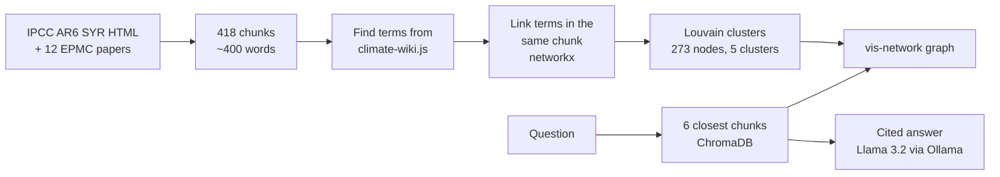

# ClimateInsight knowledge graph: one-page summary

**Author:** Anusha  · **Date:** 2026-11-04 · **Code:** `main` (merged in [PR #20](https://github.com/semanticClimate/ClimateInsight/pull/20))

**What I am trying to do:** Build a knowledge graph of the climate concepts in the ClimateInsight chatbot's source texts, so that every chatbot answer can be checked against the passages it came from.

**Source:**
- **IPCC:** IPCC AR6 Synthesis Report (SYR), Longer Report, 2023, HTML version (https://www.ipcc.ch/report/ar6/syr/), stored as `data/raw/ipcc_reference.html`.
- **EPMC query:** `("marine heatwave" OR "ocean heat wave" OR "ocean heatwave") AND ("ocean current" OR "ocean circulation" OR "Gulf Stream" OR "AMOC") AND (HAS_FT:Y)`, which gave 12 open-access papers.

**Technical plan:** Split the texts into ~400-word chunks (50-word overlap) and embed them with sentence-transformers `all-MiniLM-L6-v2` into ChromaDB. Find terms from `encyclopedia/climate-wiki.js` in each chunk with Python regex, link terms that share a chunk with networkx, cluster with Louvain (seed 42) and draw with vis-network. Answers come from Llama 3.2 (`llama3.2:latest`, 3.2B parameters, Q4_K_M, ID `a80c4f17acd5`) run locally through Ollama, served by FastAPI.

**My repository/corpus:**
- Code: https://github.com/semanticClimate/ClimateInsight (`backend/knowledge_graph.py`, `backend/concept_graph.py`)
- Papers: `data/raw/ocean_heatwaves_2026/` (12 Europe PMC XML full texts)
- IPCC report: `data/raw/ipcc_reference.html`

**What I did:** I started from Aleena Harold Peter's RAG chatbot and term list. I added a corpus-wide concept graph (`backend/knowledge_graph.py`), a page where a question is shown on the graph (`backend/concept_graph.py`, `frontend/concept_graph.html`) and tests (`backend/tests/test_knowledge_graph.py`). I also moved the chatbot to a fully local stack (Ollama only, no hosted API) and fixed citation collisions, duplicate ingest, unstable chunk IDs and false term matches (e.g. "no" being read as NO, nitric oxide).

**What results I got:** 418 passages (118 IPCC, 300 papers) → 507 Wikipedia-linked concepts in the term list → **273 found in the passages**, with **5,286 links** and **5 clusters**. The clusters are Climate change (95 concepts), Marine heatwave (81), Greenhouse gas emissions (61), Electrification (26) and Paris Agreement (10). One extra dashed link through a shared source section makes the graph fully connected. For the test question *"How have marine heatwaves in the Bay of Bengal affected food security in India's coastal fishing communities?"*, the graph nodes **Marine heatwave** (56 passages) and **Food security** (11 passages) **never occur in the same passage**. A plain text search agrees: 0 passages mention both, even counting the abbreviation "MHW" and "food insecurity".

**What the results mean:** The missing bridge is *fisheries*. It appears in 31 passages, 17 of them with marine heatwave, but it is not in the term list, so the graph cannot show the link. This is a gap in our corpus and term list, not evidence of a gap in climate research. The papers were chosen for ocean circulation, not food, and only 2 passages mention the Bay of Bengal. Links mean "discussed together", not "causes". Matching is lexical (exact text), so it misses words not in the term list: "MHW" alone appears in 119 passages that the Marine heatwave node does not count.

**Where knowledge graphs are involved:**
- **No AI builds the graph.** Nodes, links and clusters come only from text matching and counting, so every link can be traced to its passages. The LLM only writes answers and adds no nodes or links.
- **Nodes:** terms from `climate-wiki.js`, found by exact text match (longest term first, plurals listed as separate terms). Each node's identifier is its Wikipedia article, so synonyms merge into one node. These are not IPCC glossary terms.
- **Links:** undirected, labelled "occurs in the same passage", weighted by the number of shared passages.
- **Colours = clusters:** Louvain community detection in networkx (seed 42) over the whole weighted graph, computed once. The question and the LLM do not choose them. vis-network only draws the graph.
- **A question** does not create nodes. It retrieves the 6 closest passages (all-MiniLM-L6-v2, 384 numbers, ChromaDB) and highlights up to 15 concepts from the question and those passages on the existing graph, with the concept named in the question as the large central node.

Example from the graph: `Marine heatwave` (Marine heatwave cluster) and `Food security` (Climate change cluster) have no direct link; the shortest path runs through `Climate change`. `Fisheries` would join them but is missing from the term list.

