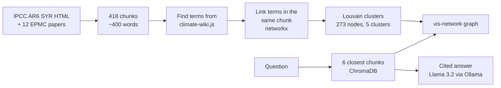
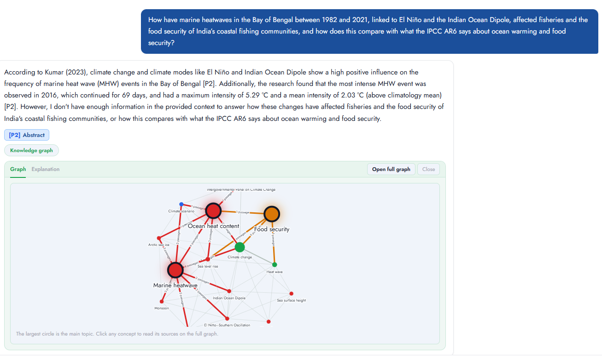
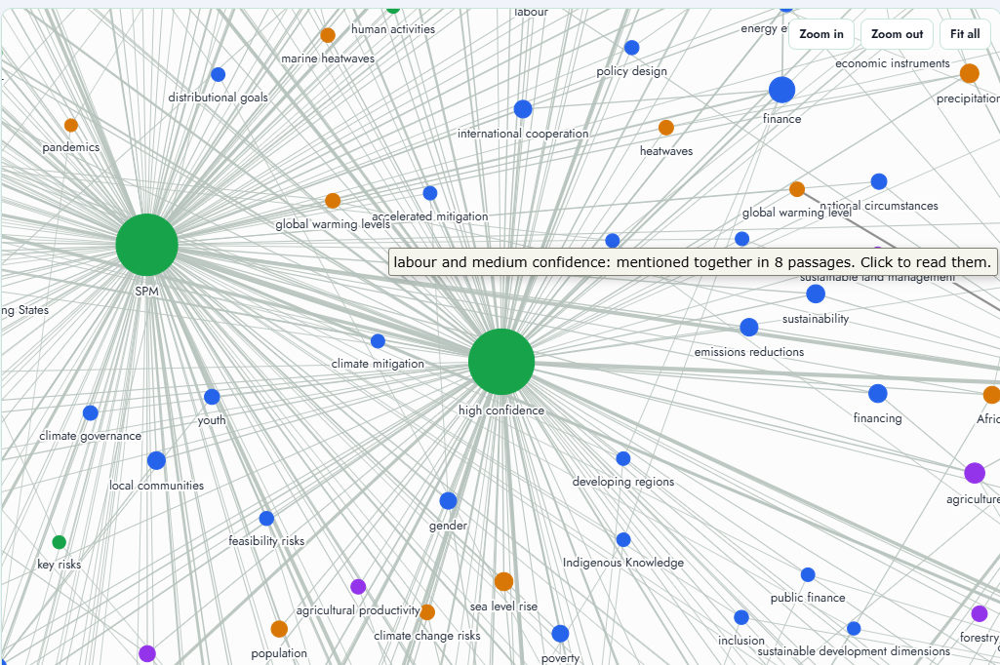
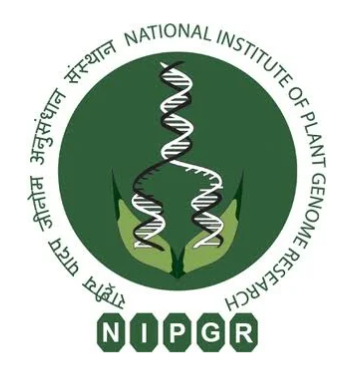

# **Marine Heatwaves in the Bay of Bengal: Fisheries, Food Security and IPCC AR6**

**Authors:** Shweata Hedge, Renu Kumari, Larisa Beni, Neel Kumar, Aleena Harold Peter, Anusha Garg, Peter Murray-Rust, Simon Worthington

## **Abstract**

semanticClimate is a global online community of interns and volunteers creating Trustable semantic knowledge on climate Change. How do they explore a new subject - "El Nino in Latin America", "climate justice"...? They face complex language and acronyms ( ENSO, SST, Southern Oscillation, climate justice...) and many different tools.

We have created a powerful toolkit (AUKGET - Automatic Universal KnowledgeGraph Encyclopedia Toolkit - Python Apache2). A single automatic pipeline command (for any subject) will:

- query the recent scientific literature for a subject from OR load a corpus (e.g. UN-IPCC)
- create and clean a corpus (BAGIT)
- extract keyphrases (KBIR)
- build an encyclopedia based on Wikipedia entries for phrases
- find inter-entry relations through bibliography and Wikimedia proximity
- create and display a knowledgeGraph (corpus and encyclopedia tightly linked)
- remove false positives (visualising and analysing outlying clusters in the KG is particularly useful)

AUKGET is available as a colab script that can be used by highschool students or citizen groups or researchers. It is deliberately AI-free but the corpus is also usable as input to AI, e.g. an LLM RAG chatbot.

## **Workflow Diagram**

## **Examples**

### **Example Query and Cited Answer**

### **Knowledge Graph Visualization**

## **Acknowledgements**

&nbsp;&nbsp;
&nbsp;&nbsp;
&nbsp;&nbsp;

